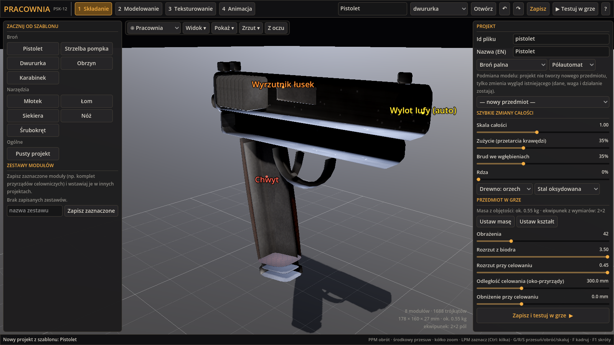
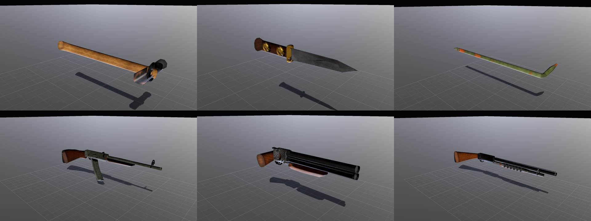
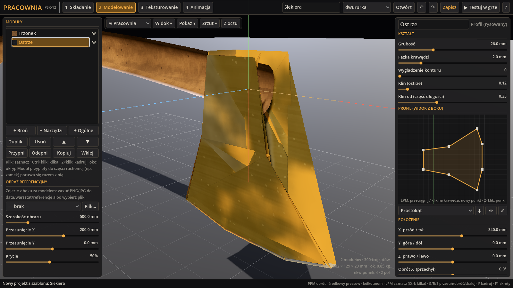
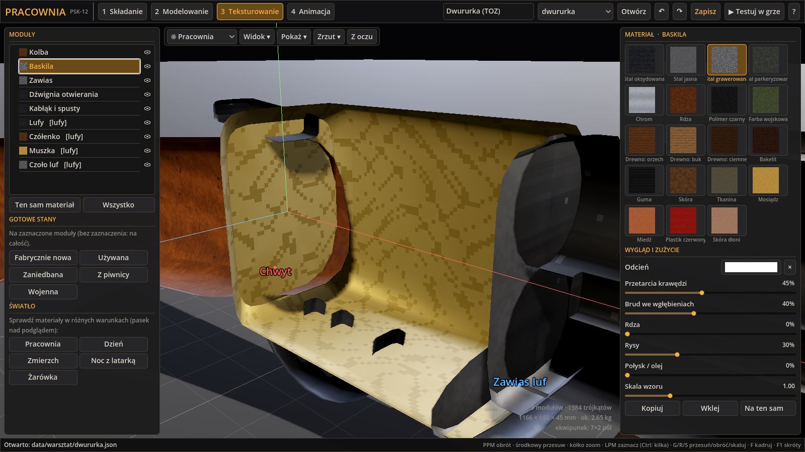
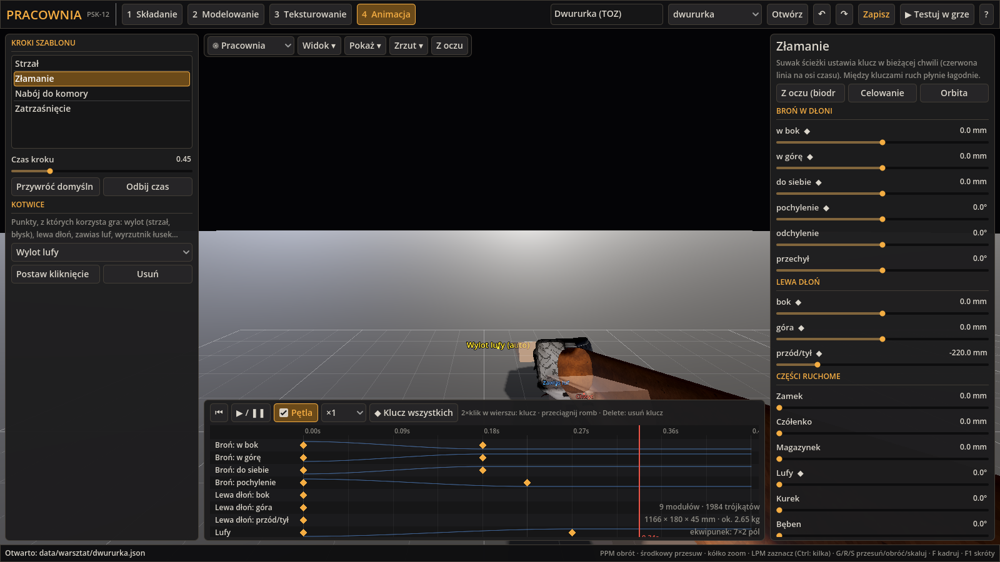

# Pracownia: instrukcja

Pracownia to narzędzie do budowy modeli broni i narzędzi z gotowych modułów, do ich
teksturowania i animowania. Wszystko, co zapiszesz, gra wczytuje sama.

Uruchomienie: w Godocie otwórz `scenes/pracownia.tscn` i wciśnij **F6**
(albo ustaw tę scenę jako bieżącą i wciśnij F5).

## Układ okna

- **Górny pasek**: zakładki 1–4, nazwa w grze, lista projektów i „Otwórz”, cofnij i powtórz,
  „Zapisz”, „Testuj w grze”, „?” (skróty).
- **Pasek nad podglądem**: oświetlenie (Pracownia, Dzień, Zmierzch, Noc z latarką, Żarówka),
  „Widok ▾” (z boku, z przodu, z góry, 3/4, z oczu, celowanie, kadruj), „Pokaż ▾” (siatka,
  kotwice, przyciąganie, linijka, wygląd PSX), „Zrzut ▾” (zrzut i arkusz obrotu 360°).
- **Podgląd**: prawy przycisk obraca, środkowy przesuwa, kółko przybliża, lewy zaznacza
  (Ctrl lub Shift: kilka modułów). Czerwony punkt „Chwyt” to miejsce prawej dłoni.
- **Pasek stanu**: co się stało; przycisk „Przywróć autozapis”, gdy jest autozapis.
- **Statystyki** (prawy dolny róg podglądu): moduły, trójkąty, wymiary, masa, pola w ekwipunku.

## Układ współrzędnych

X to przód (lufa), Y to góra, Z to prawo. Początek układu to chwyt prawej dłoni.
Narzędzia: oś X biegnie wzdłuż trzonka, chwyt jest w początku układu.
Wymiary podajesz w milimetrach (pole liczby przy suwaku przyjmuje mm i stopnie).

## 1. Składanie

Szybka praca na całości.

- **Szablony**: pistolet, strzelba pompka, dwururka, obrzyn, karabinek, młotek, łom, siekiera,
  nóż, śrubokręt, pusty projekt. Szablon ustawia moduły, kotwice, działanie i dane przedmiotu.
- **Zestawy modułów**: zaznacz moduły (np. muszkę ze szczerbinką), wpisz nazwę i „Zapisz
  zaznaczone”. Zestaw trafia do `data/warsztat/zestawy/` i można go wstawić w innym projekcie.
- **Projekt**: id pliku, nazwa angielska, rodzaj (broń palna albo przedmiot), szablon działania
  (półautomat, pompka, łamana, bez animacji).
- **Podmiana modelu**: wybierz istniejący przedmiot (np. młotek), a projekt zmieni tylko jego
  wygląd. Dane, waga i działanie przedmiotu zostają.
- **Szybkie zmiany całości**: skala całości, długość lufy (przesuwa muszkę, czoło, obejmy
  i wydłuża rurę magazynka), zużycie, brud i rdza wszystkich modułów, zamiana drewna i
  wykończenia metalu naraz.
- **Przedmiot w grze**: masa wyliczona z objętości i kształt w ekwipunku z wymiarów
  („Ustaw masę”, „Ustaw kształt”). Dla broni: obrażenia, rozrzut, odległość celowania i
  obniżenie broni przy oku.
- **Testuj w grze**: zapisuje projekt i uruchamia grę bez tworzenia postaci, z przedmiotem
  w ręku (broń dostaje amunicję). **F10** w grze wraca do Pracowni z tym samym projektem.

## 2. Modelowanie

**Drzewo modułów** (lewa kolumna): klik zaznacza, Ctrl+klik dodaje do zaznaczenia, dwuklik
kadruje, oko ukrywa. Moduły przypięte do innego są pokazane pod nim. Ikona to próbka
materiału, a w nawiasie widać część ruchomą, lustro i liczbę kopii.

**Dodawanie**: „+ Broń”, „+ Narzędzia”, „+ Ogólne”. Nowy moduł staje obok zaznaczonego.

| Grupa | Moduły |
|---|---|
| Broń | kolba, komora zamkowa, lufa/lufy (1–2, pion/poziom, szyna, mostki), czółenko/łoże, chwyt pistoletowy, zamek pistoletu (rowki, okno), magazynek (pochylenie, wygięcie łukowe), kabłąk ze spustami, muszka (z osłoną), szczerbinka (albo przeziernik), rura magazynka, kurek, bęben rewolweru, luneta, tłumik |
| Narzędzia | trzonek (spłaszczenie, zwężenie, zgrubienie, wygięcie), pręt zgięty (łom: kąt i promień zgięcia, kanciastość, spłaszczony koniec) |
| Ogólne | pierścień/opaska, walec (stożek, liczba ścian), kula/gałka, pudełko/płytka (kanciastość, fazka, zwężenie), **profil** |

**Profil** to dowolny kształt narysowany punktami w widoku z boku i wyciągnięty na grubość:
ostrza, kolby, dźwignie, okładziny. W edytorze profilu:
- przeciągnij punkt; klik na krawędzi wstawia punkt; dwuklik dodaje punkt na końcu;
  prawy przycisk usuwa punkt; kółko i środkowy przycisk zmieniają widok; Shift wyłącza
  przyciąganie do siatki 1 mm;
- gotowe kształty: prostokąt, ostrze siekiery, ostrze noża, kolba, chwyt rewolweru,
  głowica młotka;
- ↕ dorysowuje lustrzaną połowę (rysujesz górę, dostajesz całość), ↔ odwraca przód z tyłem;
- **fazka** ścina krawędzie, **wygładzenie** zaokrągla kontur, **klin** zwęża grubość
  ku przodowi (ostrze), **klin od** mówi, od którego miejsca.

**Inspektor** (prawa kolumna): nazwa, parametry kształtu, położenie, obrót, skala, a także:
- **Lustro**: kopia odbita na drugą stronę osi Z (okładziny chwytu, bolce);
- **Powtórzenie**: rząd kopii co zadany krok (rowki, nity, mostki szyny); działa razem
  z lustrem;
- **Rola**: część ruchoma (zamek, magazynek, lufy, czółenko, kurek, bęben). Dzieci dziedziczą
  rolę rodzica, więc muszka przypięta do zamka odskakuje razem z nim;
- **Rodzic**: moduł porusza się razem z rodzicem, a jego położenie liczy się od rodzica.
  „Przypnij” w drzewie: zaznacz moduły, na końcu Ctrl+klik na rodzicu. Przypinanie i
  odpinanie zachowuje położenie w świecie.

**Transformacja myszą** (jak w Blenderze): **G** przesuwa, **R** obraca, **S** skaluje.
W trakcie X/Y/Z zawęża do osi, lewy przycisk lub Enter zatwierdza, prawy lub Esc anuluje,
Ctrl chwilowo wyłącza przyciąganie (1 mm, 5°, ×0,05). Działa na wszystkie zaznaczone.

**Linijka** („Pokaż ▸ Linijka”): kliknij dwa punkty na modelu, dostaniesz odległość i
różnice w osiach.

**Obraz referencyjny**: zdjęcie z boku za modelem do odrysowania. Wrzuć PNG/JPG do
`data/warsztat/referencje/` albo wybierz plik z dysku. Suwaki: szerokość, przesunięcie, krycie.

## 3. Teksturowanie

19 materiałów: stal oksydowana, jasna, grawerowana, parkeryzowana, chrom, rdza, polimer,
farba wojskowa, drewno (orzech, buk, ciemne), bakelit, guma, skóra, tkanina, mosiądz, miedź,
plastik czerwony, skóra dłoni.

Zużycie liczy się samo z kształtu modelu. Przetarcia pojawiają się na wypukłych krawędziach,
brud w zagłębieniach, a rdza w plamach, chętniej w zagłębieniach. Nie trzeba niczego malować.

- **Odcień**: przyciemnij lub zabarw materiał (np. zielonkawy polimer).
- **Przetarcia, brud, rdza, rysy, połysk, skala wzoru**: suwaki działają na wszystkie
  zaznaczone moduły.
- **Gotowe stany**: fabrycznie nowa, używana, zaniedbana, z piwnicy, wojenna.
- **Kopiuj/Wklej** przenosi materiał i zużycie; „Na ten sam materiał” ujednolica wszystkie
  moduły z tym materiałem; „Ten sam materiał” w drzewie zaznacza je.
- Sprawdź model w każdym świetle: dzień, zmierzch, noc z latarką, żarówka.

## 4. Animacja

**Kotwice**: wylot lufy (strzał, błysk, dym), lewa dłoń (podparcie), gniazdo magazynka,
wyrzutnik łusek (stąd wylatują łuski w grze), zawias luf, oś bębna, oś kurka.
„Postaw kliknięciem” i klik na modelu stawia kotwicę na powierzchni; suwaki ją dosuwają.
Bez kotwicy gra liczy wylot sama (koniec lufy) i używa punktu podparcia z szablonu.

**Kroki** zależą od szablonu działania:
- półautomat: strzał, wyjęcie magazynka, włożenie magazynka, przeładowanie zamka,
  usunięcie zacięcia;
- pompka: strzał, pompka, ładowanie naboju, przeładowanie;
- łamana: strzał, złamanie, nabój do komory, zatrzaśnięcie.

Każdy krok ma czas i ścieżki:
- broń w dłoni: w bok, w górę, do siebie (mm), pochylenie, odchylenie, przechył (stopnie);
- lewa dłoń: bok, góra, przód/tył (mm, w układzie broni w dłoni);
- części ruchome: zamek i czółenko (mm do tyłu), magazynek (mm w dół), lufy i kurek
  (stopnie), bęben (stopnie).

**Jak animować**: wybierz krok, przesuń czerwoną linię na osi czasu i ustaw suwak
ścieżki. Klucz wstawia się sam w tej chwili. Między kluczami ruch płynie łagodnie.
Na osi czasu: dwuklik w wierszu wstawia klucz z bieżącą wartością, romb da się przeciągnąć
w czasie, a Delete usuwa zaznaczony klucz. „◆ Klucz wszystkich” zatrzymuje pozę.
„Odbij czas” odwraca ruch, np. otwieranie w zamykanie. Spacja odtwarza; prędkość ×0,1–×1.

**Podgląd z oczu**: „Z oczu (biodro)” i „Celowanie” pokazują broń tak, jak trzyma ją postać
(półprzezroczyste bryły to dłonie).

Kroki bez zmian mają domyślny ruch szablonu, ten sam co w grze. Zmieniony krok
(oznaczony ● na liście) trafia do pliku projektu i gra używa go zamiast domyślnego, łącznie
z czasem kroku. „Przywróć domyślny” usuwa zmiany. Zdarzenia (np. `dzwiek:gun_rack`)
zapisują się w pliku na przyszłość; gra jeszcze ich nie odtwarza.

## Skróty

| Klawisz | Działanie |
|---|---|
| 1 2 3 4 | zakładki |
| G / R / S | przesuń / obróć / skaluj myszą (X/Y/Z: oś) |
| Ctrl+D lub Shift+D | duplikuj |
| Ctrl+C / Ctrl+V | kopiuj / wklej moduły (także między projektami) |
| Delete (Shift+X) | usuń |
| H / Alt+H | ukryj / pokaż wszystko |
| F (Num .) | kadruj zaznaczenie |
| Num 1 / 3 / 7 / 5 | widok z boku / przodu / góry / 3/4 |
| V | podgląd z oczu |
| PageUp / PageDown | kolejność modułu |
| Ctrl+A | zaznacz wszystko |
| Ctrl+Z / Ctrl+Y | cofnij / powtórz (200 kroków) |
| Ctrl+S | zapisz |
| Spacja | odtwórz krok animacji |
| F12 | zrzut podglądu do `user://pracownia` |
| F1 | ściąga skrótów |

## Pliki

- `data/warsztat/<id>.json`: projekt (moduły, kotwice, animacja, dane przedmiotu).
- `data/warsztat/zestawy/<nazwa>.json`: zestawy modułów.
- `data/warsztat/referencje/`: obrazy referencyjne.
- `user://pracownia_autozapis.json`: autozapis co 45 s, gdy są niezapisane zmiany.
- `user://pracownia/`: zrzuty i arkusze obrotu.

Kod: `scripts/pracownia/` (`core.gd` moduły i geometria, `materials.gd` materiały i shader
zużycia, `anim.gd` ścieżki animacji, `templates.gd` szablony i zestawy, `pracownia.gd` okno,
`profile_editor.gd`, `timeline.gd`, `ui_kit.gd` wygląd).
